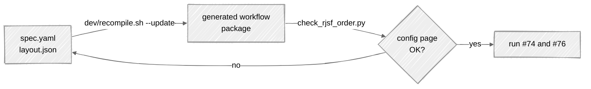
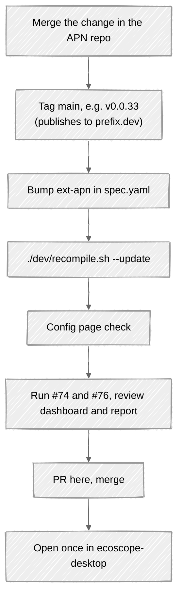

# Developing the APN Patrol & Event workflow

This page is for whoever maintains the workflow. For what it does and how to use it, see the [README](README.md).

## Where the data comes from

The patrol and its legs come from EarthRanger's patrol segments API. The APN tasks live in the [`ecoscope-workflows-ext-apn`](https://github.com/wildlife-dynamics/APN) package: `get_patrol_segments_info`, `get_patrol_stats`, `get_patrol_legs_table`, `prepare_patrol_report_context` and `generate_patrol_report`.

| Report part | EarthRanger source |
|---|---|
| Patrol ID, start and end | The patrol's `serial_number` and its legs' time ranges |
| Leaders and members | Each leg's leader and members |
| Mandates and leg details | Leg forms: `segment_details`, plus `type_details` for vehicle, boat or horse legs |
| Distance per leg | GPS track segments that start within the leg's time range |
| Events | Events linked to the legs, including ones whose type has since been deactivated |
| Cierre de Patrulla | A linked `cierre_de_patrulla` event |

## The report template

The layout is [`resources/templates/apn_patrol_events_template.docx`](resources/templates/apn_patrol_events_template.docx), a Word file with [docxtpl](https://docxtpl.readthedocs.io) (Jinja) tags. The Report Template field defaults to its raw GitHub URL on `main`, so every run downloads it. To change it, edit the file, test it by pointing Report Template at your local copy, and merge. Template changes need no recompile.

## Setup

You'll need [pixi](https://pixi.sh) and an EarthRanger connection for the site you test against.

The workflow is described in **`spec.yaml`**: its steps, the config page overrides (including the section order) and the dependency versions. **`layout.json`** places the dashboard widgets, and **`resources/templates/`** holds the Word template. Everything in `ecoscope-workflows-patrol-event-workflow/` is generated from those, so don't edit it by hand.



### Compile

After changing `spec.yaml` or a dependency version, run:

```bash
./dev/recompile.sh --update
```

`--update` keeps the existing lockfile and bumps the workflow version. If you only changed config page overrides, `./dev/regenerate_rjsf.sh` rebuilds just the form, in seconds.

### Check the config page

ecoscope-desktop refuses a config page whose section order is incomplete, so check it after every compile:

```bash
.pixi/envs/default/bin/python dev/check_rjsf_order.py ecoscope-workflows-patrol-event-workflow/ecoscope_workflows_patrol_event_workflow/rjsf.json
```

It prints `ui:order OK`, or names each section that's missing or extra.

### Run against real data

```bash
cd ecoscope-workflows-patrol-event-workflow
ECOSCOPE_WORKFLOWS_RESULTS="file:///tmp/apn-patrol-event" \
  pixi run ecoscope-workflows-patrol-event-workflow run \
  --config-file ../param.yaml --execution-mode sequential --no-mock-io
```

The dashboard data is written to `result.json` and the report to `*_Patrol_Report_<ID>.docx`. On apn-central, patrol **#74** is a good all-round test (three legs, events in several categories), and **#76** has an end-of-patrol form.

### Dependency versions

The APN tasks come from [`ecoscope-workflows-ext-apn`](https://github.com/wildlife-dynamics/APN) and the shared ones from `ecoscope-workflows-ext-custom`. Both are pinned to exact versions. `ecoscope-platform` is a range, so the solver picks the newest version that works with ext-custom.

`wt-compiler` is capped at `>=0.8.2,<0.11` in `pixi.toml`, because 0.11 requires `wt-task >=0.3`, which ext-custom doesn't support yet. Lift the cap once it does.

---

## Releasing

Most changes need a new version of ext-apn, the package with the APN tasks, and then a recompile here:



The last step matters: ecoscope-desktop validates the config page more strictly than a local run does.
