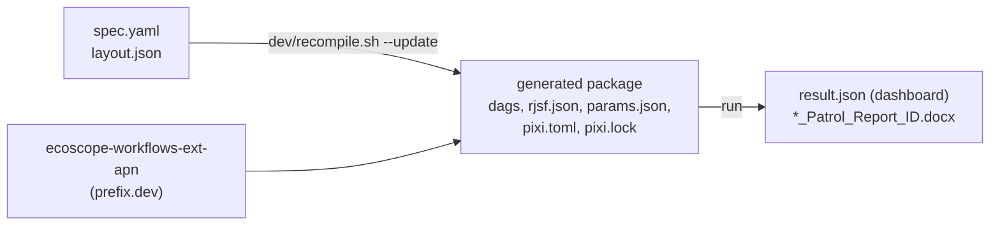
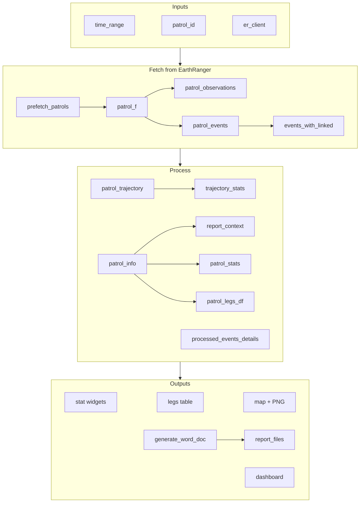

# Development guide

Technical reference for maintaining the APN Patrol & Event workflow. For what the workflow does from a user's point of view, see the [README](README.md).

- [How the workflow is built](#how-the-workflow-is-built)
- [Repository layout](#repository-layout)
- [Pipeline](#pipeline)
- [ext-apn tasks](#ext-apn-tasks)
- [Report template](#report-template)
- [Config page](#config-page)
- [Building and testing](#building-and-testing)
- [Dependencies](#dependencies)
- [Releasing](#releasing)
- [Known limitations](#known-limitations)

---

## How the workflow is built

The workflow is declared in `spec.yaml` and compiled by **wt-compiler** into a standalone Python package, `ecoscope-workflows-patrol-event-workflow/`. ecoscope-web and ecoscope-desktop run that package: they render the config page from its `rjsf.json`, pass the user's answers as parameters, and execute the DAG in `dags/run_sequential.py`.

Each step in the spec calls a registered task. Most tasks come from `ecoscope-platform` and `ecoscope-workflows-ext-custom`. The APN-specific logic (patrol legs, stats, the report) lives in [`ecoscope-workflows-ext-apn`](https://github.com/wildlife-dynamics/APN), in the APN monorepo, and is pulled in as a pinned conda package.



## Repository layout

| Path | Contents | Edit by hand? |
|---|---|---|
| `spec.yaml` | Steps, task arguments, config page overrides (`rjsf-overrides`), dependency versions (`requirements`) | Yes |
| `layout.json` | Dashboard grid: position and size of each widget, by widget index | Yes |
| `resources/templates/apn_patrol_events_template.docx` | Word report template (docxtpl) | Yes |
| `param.yaml`, `test-cases.yaml` | Example parameters and test cases | Yes |
| `dev/recompile.sh` | Full compile (`pixi update` + `wt-compiler compile --clobber`) | Rarely |
| `dev/regenerate_rjsf.sh` | Rebuilds only `rjsf.json`, for override-only changes | Rarely |
| `dev/check_rjsf_order.py` | Validates the config page's `ui:order` | Rarely |
| `pixi.toml`, `pixi.lock` | Environment for the build tools (wt-compiler) | Version bumps only |
| `ecoscope-workflows-patrol-event-workflow/` | Generated package | **No**, regenerate it |
| `docs/images/` | README diagrams | Yes |

## Pipeline

The spec runs these stages in order. Step ids match `spec.yaml`.



| Stage | Steps | What happens |
|---|---|---|
| Inputs | `workflow_details`, `er_client`, `time_range`, `patrol_id`, `get_template_path`, `base_maps` | Config page values. `patrol_id` and `get_template_path` are plain strings (`set_string_var`). |
| Fetch | `prefetch_patrols` (`get_patrols_any_type`), `patrol_f` (`filter_patrols_by_serial`) | All patrols overlapping the time range, of any type and status, then only the one whose serial number is `patrol_id`. |
| | `patrol_observations`, `patrol_events` | The patrol's GPS observations and its linked events, both converted to the workflow timezone. |
| | `events_with_linked` (`add_missing_linked_events`) | Fetches linked events the patrol listing omits, e.g. events whose type has since been deactivated. |
| Process | `patrol_relocations`, `patrol_trajectory` (`trajectory_or_empty`) | Relocations to a trajectory. Returns an empty frame instead of failing when the track is too short. |
| | `trajectory_stats`, `total_distance_km` | Distance and duration from the trajectory. |
| | `processed_events_details`, `mapped_events`, `events_with_lat_lon` | Event form fields resolved to labels, categories mapped, coordinates added. |
| | `patrol_info` (`get_patrol_segments_info`) | Legs, teams, mandates, leg forms and the closing form. |
| | `report_context` (`prepare_patrol_report_context`) | Groups events by category and formats them for the template. |
| | `patrol_stats`, `patrol_legs_df` | Headline numbers and the legs table. |
| Outputs | `stat_*_sv`, `patrol_legs_table_sv`, `patrol_event_map_widget` | Dashboard widgets. Tile units come from `with_unit`. |
| | `patrol_event_map_to_png`, `download_attachments`, `sanitized_attachments` | Static map and photos for the report. |
| | `generate_word_doc` (`generate_patrol_report`), `report_files` | Renders the `.docx` and lists it in the dashboard's files tab. |
| | `dashboard` (`gather_dashboard`) | Assembles widgets, files and the time range into `result.json`. |

Steps skip by default when an input is empty (`task-instance-defaults: any_is_empty_df, any_dependency_skipped`). Steps that must run anyway, such as `patrol_info` or the stat widgets, set `skipif: never`.

## ext-apn tasks

| Task | Input | Output |
|---|---|---|
| `get_patrols_any_type` | ER client, time range, patrol params | Patrols of every type, including ones without a patrol type |
| `filter_patrols_by_serial` | Patrols, `patrol_id` | The one matching patrol. A blank ID returns all patrols. |
| `add_missing_linked_events` | Patrols, events | Events plus linked events fetched one by one from `activity/event/{id}` |
| `trajectory_or_empty` | Relocations, segment filter | A trajectory, or an empty GeoDataFrame when there's no usable track |
| `get_patrol_segments_info` | ER client, patrol, events, timezone | `patrol_info` dict (see below). Raises *"No patrol matches the 'ID de Patrulla'…"* when the patrol is missing. |
| `prepare_patrol_report_context` | Events, `patrol_info`, timezone | `eventos_resumen`, `eventos_por_categoria`, `events` |
| `get_patrol_stats` | `patrol_info`, distance, events | `{km, horas, tramos, eventos}` |
| `get_patrol_legs_table` | `patrol_info`, trajectory | DataFrame: `#, Tipo, Inicio, Fin, Líder, Distancia (km), Tiempo (h)` |
| `generate_patrol_report` | Context, trajectory, events, map, attachments, template path or URL | Path to the rendered `.docx` |

How `get_patrol_segments_info` reads EarthRanger:

| Field | Source |
|---|---|
| Legs | `patrol_segments` of the patrol, sorted by start time |
| Leader, members | Each segment's `leader` and `members`, resolved through `subject/{id}` |
| Leg form | `segment_details` (schema: `activity/patrols/segments/types/default/schema/`) and `type_details` (schema: `activity/patrols/types/{type}/schema`) |
| Choice labels | `schemas/choices.json?field=…` |
| Closing form | A linked event of type `cierre_de_patrulla` |
| Distance per leg | Trajectory segments whose `segment_start` falls in the leg's `[start, end)` |
| Hours | Leg duration, summed for the headline number |

## Report template

The template is rendered with [docxtpl](https://docxtpl.readthedocs.io). `generate_patrol_report` accepts a local path or an http(s) URL. The Report Template field defaults to the raw GitHub URL of the file on `main`, so template changes go live when they're merged, with no recompile.

Context available to the template:

| Variable | Contents |
|---|---|
| `outing_id`, `start_time`, `end_time` | Patrol serial number, start and end (`dd/mm/yyyy HH:MM`) |
| `stats` | `km`, `horas` (2 decimals), `tramos`, `eventos` |
| `patrol_info.mandatos` | List of mandates |
| `patrol_info.equipos` | `[{lider, integrantes, personal_no_listado}]` |
| `patrol_info.tramos` | `[{n, tipo, fecha, horario, lider, km, horas, detalles_texto}]` |
| `patrol_info.cierre` | `[[{campo, valor}]]`, one list per closing form |
| `eventos_resumen` | `[{categoria, tipos, cantidad}]` |
| `eventos_por_categoria` | `[{categoria, eventos: [{serial_number, event_type_display, hora, coordenadas, detalles}]}]` |
| `map` | Inline image of the patrol map |
| `attachments` | `[{details, image}]` |
| `notes` | Event notes. Currently always empty (see [Known limitations](#known-limitations)). |
| `user` | The user running the workflow (`first_name`, `last_name`) |

Template conventions:

- Table rows loop with `` / ``; whole paragraphs with `` / ``.
- A `\n` inside a value renders as a line break. Multi-line cells (`hora`, `coordenadas`, `detalles`) rely on this.
- Test a change by setting Report Template to your local file and running #74 and #76.

## Config page

The config page is generated from the task signatures, then adjusted by `rjsf-overrides` in `spec.yaml`:

- **Titles, descriptions, defaults and `ecoscope:advanced`** are set under `rjsf-overrides.properties`.
- **Section order** is the top-level `uiSchema.ui:order`. It ends with `"*"` so that a new section lands at the bottom instead of making ecoscope-desktop reject the form.
- **Keeping arguments off the form:** any task argument not set in the spec's `partial` becomes a form field. Pin it in the spec to hide it, as with `new_unit: null` on the tile units and `event_states: null` on the event queries.

ecoscope-desktop validates `ui:order` strictly (a missing section is an error), while a local run doesn't. Check it after every compile:

```bash
.pixi/envs/default/bin/python dev/check_rjsf_order.py \
  ecoscope-workflows-patrol-event-workflow/ecoscope_workflows_patrol_event_workflow/rjsf.json
```

For override-only changes, `./dev/regenerate_rjsf.sh` rebuilds `rjsf.json` in seconds without resolving environments. It doesn't touch the DAG, so step changes still need a full compile.

## Building and testing

Requirements: [pixi](https://pixi.sh), and an EarthRanger connection named in the params (`apncentral` for apn-central).

**Compile** after changing `spec.yaml` or a dependency version:

```bash
./dev/recompile.sh --update
```

`--update` keeps the existing `pixi.lock` and bumps the version in `VERSION.yaml`. Without it, the lockfile is regenerated from scratch. A compile resolves and downloads the workflow environment, which can take several minutes. Network timeouts on conda downloads are transient, so re-run.

**Run** against real data:

```bash
cd ecoscope-workflows-patrol-event-workflow
ECOSCOPE_WORKFLOWS_RESULTS="file:///tmp/apn-patrol-event" \
  pixi run ecoscope-workflows-patrol-event-workflow run \
  --config-file ../param.yaml --execution-mode sequential --no-mock-io
```

Outputs in the results folder:

- `result.json`: `result.views["{}"]` holds `dashboard` (the widgets) and `files` (the report). `error` is set when the run failed.
- `*_Patrol_Report_<ID>.docx`: the report.
- HTML and PNG files for the map and the legs table.

**Test patrols on apn-central:**

| Patrol | Why |
|---|---|
| #74 | Three legs (truck, horseback, on foot), seven events in five categories |
| #76 | Has a closing form (`cierre_de_patrulla`) |
| #70–72 | Legs with no linked events |

Before a release, also open the workflow in ecoscope-desktop: it is the only place the config page validation runs.

## Dependencies

| Package | Where | Constraint | Why |
|---|---|---|---|
| `ecoscope-workflows-ext-apn` | `spec.yaml` | exact | APN tasks. Bump after each ext-apn release. |
| `ecoscope-workflows-ext-custom` | `spec.yaml` | exact | Shared tasks: attachments, `download_remote_file`. |
| `ecoscope-platform` | `spec.yaml` | `>=2.17.0,<3.0.0` | The solver picks the newest version compatible with ext-custom (currently 2.28.0). |
| `wt-compiler` | `pixi.toml` | `>=0.8.2,<0.11` | wt-compiler 0.11 makes compiled workflows require `wt-task >=0.3`, but every ext-custom release requires `wt-task <0.2`. Lift the cap once ext-custom moves to wt-task 0.3. |

## Releasing

When a change needs new ext-apn code:

1. Merge the change into the [APN repo](https://github.com/wildlife-dynamics/APN)'s `main`, then tag it (`git tag v0.0.33 && git push origin v0.0.33`). The tag triggers the Publish workflow, which uploads the package to `repo.prefix.dev/ecoscope-workflows-custom`.
2. Set `ecoscope-workflows-ext-apn` in `spec.yaml` to the new version.
3. `./dev/recompile.sh --update`
4. Run the config page check.
5. Run #74 and #76, and review the dashboard and the report.
6. Open a PR here and merge it.
7. Open the workflow in ecoscope-desktop to confirm the config page loads.

Template-only changes skip steps 1–4: edit the `.docx`, test it with a local Report Template path, and merge.

## Known limitations

- **Event notes are off.** `generate_word_doc` is passed `notes: []`, so the NOTAS section never appears. To turn notes back on, pass `${{ workflow.safe_notes.return }}` instead. The template already hides the section when notes are empty.
- **Deactivated event types** show their raw category and field codes: the label lookups only cover active event types.
- **Distance per leg** depends on the GPS track. Legs of a minute or two often have no track points and show `0.00 km`.
- **Dashboard number formatting:** the legs table shows plain numbers, so `0.20` displays as `0.2`.
