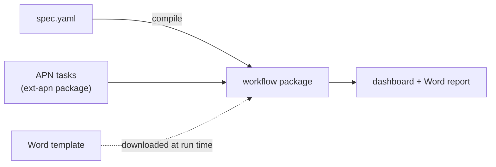
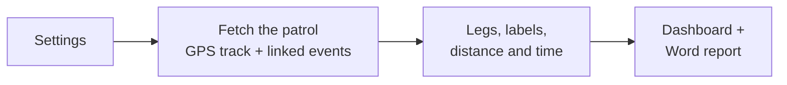

# Development guide

This page is for whoever maintains the workflow: how it fits together, where to make a change, and how to test and release it. For what the workflow does for its users, see the [README](README.md).

---

## The big picture

The workflow has three parts:

1. **`spec.yaml`, in this repository.** A list of steps describing what the workflow does: fetch the patrol, build the map, create the report, and so on. A tool called **wt-compiler** turns it into a runnable Python package (the `ecoscope-workflows-patrol-event-workflow/` folder). That package is what Ecoscope runs.
2. **The APN tasks.** The APN-specific logic, such as reading patrol legs, computing the headline numbers and filling in the report, lives in the `ecoscope-workflows-ext-apn` package in the [APN repository](https://github.com/wildlife-dynamics/APN). This workflow uses a released version of it.
3. **The Word template** in `resources/templates/`. It controls how the report looks. Every run downloads it from `main`.



## Where to make a change

| You want to… | Change | Then |
|---|---|---|
| Change how the report looks | `resources/templates/apn_patrol_events_template.docx` | Merge. No compile needed. |
| Add, remove or move something on the dashboard | `spec.yaml` (the step) and `layout.json` (its position) | Compile |
| Change the config page (labels, defaults, order) | `rjsf-overrides` in `spec.yaml` | Compile, then run the config page check |
| Change how patrol data is read or calculated | The APN tasks, in the [APN repository](https://github.com/wildlife-dynamics/APN) | Release a new ext-apn version, then bump it here |

Never edit the generated `ecoscope-workflows-patrol-event-workflow/` folder by hand. It's rebuilt on every compile.

---

## How a run works



Outputs that depend on missing data are skipped, so a patrol with no GPS track still gets a report, just without distances or a map.

---

## The report template

The template is a normal Word document with placeholders in it, filled in by [docxtpl](https://docxtpl.readthedocs.io) (Jinja syntax). For example, `{{ stats.km }}` becomes `4.05`.

The main placeholders:

- `outing_id`, `start_time`, `end_time`: the patrol number and its dates
- `stats`: the four headline numbers (`km`, `horas`, `tramos`, `eventos`)
- `patrol_info`: mandates (`mandatos`), teams (`equipos`), legs (`tramos`) and the closing form (`cierre`)
- `eventos_resumen` and `eventos_por_categoria`: the events summary and the events grouped by category
- `map` and `attachments`: the map image and the event photos

A few things to know when editing:

- Table rows repeat with `` … ``, and whole paragraphs can be shown or hidden with `` … ``.
- Line breaks inside a value (like an event's details) come out as separate lines in the cell.
- To try a change, point the Report Template setting at your local copy of the file and run a test patrol.

---

## Build, check and test

You'll need [pixi](https://pixi.sh) and access to an EarthRanger site (for testing, `apncentral`).

**Compile** after changing `spec.yaml`:

```bash
./dev/recompile.sh --update
```

This rebuilds the workflow package and bumps its version. It can take a few minutes, because it downloads the packages the workflow needs. If it fails on a network timeout, just run it again.

If you only changed the config page (labels, defaults, order), there's a much faster option that only rebuilds the form:

```bash
./dev/regenerate_rjsf.sh
```

**Check the config page.** Ecoscope desktop refuses to open the form if a section is missing from its order list, and a local run won't warn you. After every compile, run:

```bash
.pixi/envs/default/bin/python dev/check_rjsf_order.py \
  ecoscope-workflows-patrol-event-workflow/ecoscope_workflows_patrol_event_workflow/rjsf.json
```

It should print `ui:order OK`.

**Run it** with the example settings in `param.yaml`:

```bash
cd ecoscope-workflows-patrol-event-workflow
ECOSCOPE_WORKFLOWS_RESULTS="file:///tmp/apn-patrol-event" \
  pixi run ecoscope-workflows-patrol-event-workflow run \
  --config-file ../param.yaml --execution-mode sequential --no-mock-io
```

The Word report and `result.json` (the dashboard) are written to `/tmp/apn-patrol-event`. If the run failed, `result.json` says why.

**Good test patrols** on apn-central:

- **#74**: three legs (truck, horseback, on foot) and seven events in five categories
- **#76**: has a closing form
- **#70–72**: legs but no events

---

## Releasing

If your change needs new APN task code:

1. Merge it in the [APN repository](https://github.com/wildlife-dynamics/APN), then tag `main` with the next version, e.g. `v0.0.33`. The tag publishes the package automatically.
2. In `spec.yaml`, set `ecoscope-workflows-ext-apn` to that version.
3. Compile, run the config page check, and run #74 and #76.
4. Open a pull request here and merge it.
5. Open the workflow once in Ecoscope desktop to make sure the config page loads.

Template-only changes just need step 4.

---

## Good to know

- **Event notes are switched off.** The report step is given an empty list of notes, so the notes page never appears. To switch them on, change `notes: []` in the `generate_word_doc` step to `${{ workflow.safe_notes.return }}`.
- **Old event types** that were deactivated in EarthRanger show raw codes instead of labels, because their labels can't be looked up any more.
- **Very short legs** often show `0.00 km`, because there are no GPS points recorded during them.
- **wt-compiler is held below version 0.11** in `pixi.toml`. Newer versions need a newer `wt-task` library than ext-custom supports. Lift the limit once ext-custom catches up.
- **Hiding a setting from the config page:** any task setting that isn't fixed in `spec.yaml` shows up as a form field. To hide one, give it a value in the spec, as is done with `new_unit: null` on the headline numbers.
