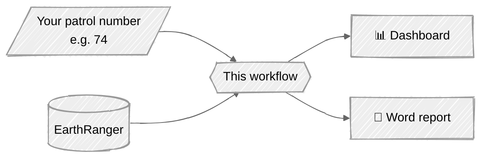
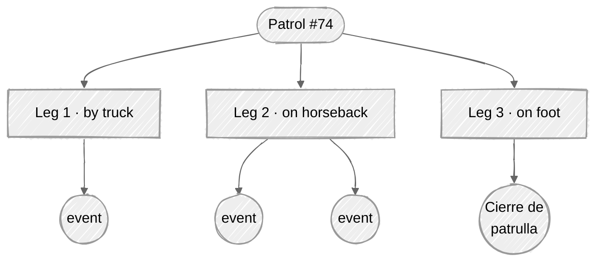
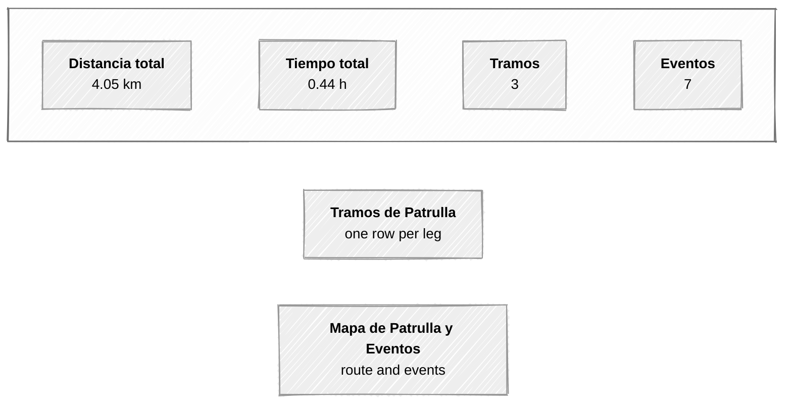
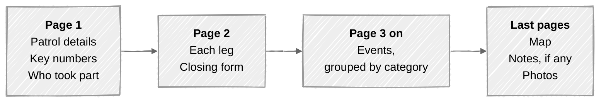

# APN Patrol & Event Report

Turn one EarthRanger patrol into a **dashboard** and a ready-to-print **Word report**, in the format used by Argentina's national parks agency (Administración de Parques Nacionales, **APN**).

You give it a patrol number. It gathers everything recorded on that patrol (who went, each stretch of the trip, what they found, how it ended) and lays it out for you.

---

## Before you start

In EarthRanger, a patrol is made of **legs** (*tramos*). The team starts a new leg whenever something changes: they switch from the truck to horses, a different person leads, or the mandate changes. Each leg has its own leader, team and a short form.

Anything the team records on the way (a sighting, a threat, an infraction) is an **event** linked to the leg it happened on. When the patrol is over, the team can fill in the end-of-patrol form, **Cierre de patrulla**.

The report is only as complete as what was recorded: a leg without a form, or a patrol without a closing form, simply shows less.

---

## How to run it

1. **Choose the data source**, for example `apncentral`.
2. **Set the time range** so it includes the day of the patrol, and choose the Buenos Aires timezone.
3. **Enter the ID de Patrulla**: the patrol's number as shown in EarthRanger, for example `74`.
4. *(Optional)* Add map layers such as the park boundary, adjust the map colors, and choose whether event photos go into the report (**Download Attachments**).
5. **Run it.** The dashboard appears, and the Word report is ready to download.

You can ignore the two settings at the bottom, **Base Maps** and **Report Template**. They're already set up.

---

## What you get

### The dashboard

At the top are four numbers for the patrol. Below them is a table with one row per leg, then a map of the route with the events marked.

| On the dashboard | In English | What it shows |
|---|---|---|
| Distancia total | Total distance | How far the patrol travelled, from the GPS track |
| Tiempo total | Total time | How long the patrol lasted, adding up all the legs |
| Tramos | Legs | How many legs the patrol had |
| Eventos | Events | How many events were recorded (the closing form isn't counted) |
| Tramos de Patrulla | Patrol legs | Each leg's type, start, end, leader, distance and time |
| Mapa de Patrulla y Eventos | Patrol and events map | The route, colored by leg type, with the events marked |

### The Word report

The report follows APN's layout, page by page:

- **Page 1** shows the patrol number, its mandates, when it started and ended, the same four numbers as the dashboard, and **who took part**: each leader with their team, plus anyone who joined without an EarthRanger account.
- **Page 2** goes through the patrol **leg by leg**: how they travelled, when, who led, the distance and time, and what was filled in on the leg's form. The **closing form** follows on the same page, or a note saying none was filed.
- **The events** come next, first as a short summary and then one table per category, each with the event's number, type, time, coordinates and details.
- **At the end** are the map, any notes, and the event photos. The notes page only appears when there are notes.

Times are in Buenos Aires time, and every answer is written out in full words, not as EarthRanger codes.

---

## Common questions

**The run stops with "No patrol matches the 'ID de Patrulla' in the selected time range".**
The patrol isn't inside the dates you picked, or the number is wrong. Widen the time range and check the number in EarthRanger.

**Distancia total shows 0.00 km.**
The patrol has little or no GPS track, for example when the legs only lasted a minute or two.

**Eventos shows 0, but the report has a closing form.**
That's expected. The closing form has its own section and isn't counted as an event.

**A field shows a code instead of a word.**
That event type was switched off in EarthRanger after the event was recorded, so its labels are no longer available.

**I want to change how the report looks.**
The report layout is a Word file in this repository, [`resources/templates/apn_patrol_events_template.docx`](resources/templates/apn_patrol_events_template.docx). Ask the Ecoscope team to update it. Changes take effect on the next run, with nothing to reinstall.

---

For developers: how to compile, check and release this workflow is in [DEVELOPMENT.md](DEVELOPMENT.md).
