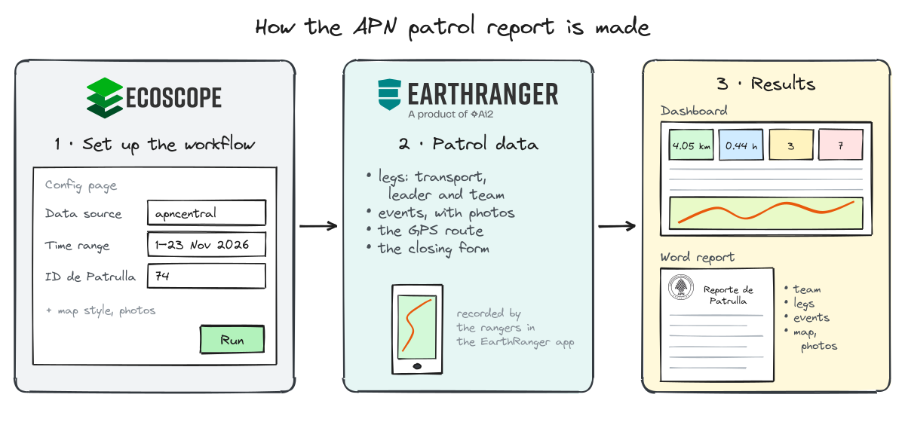
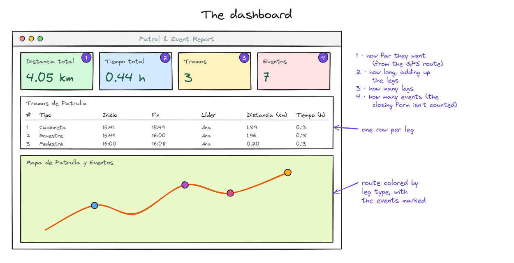
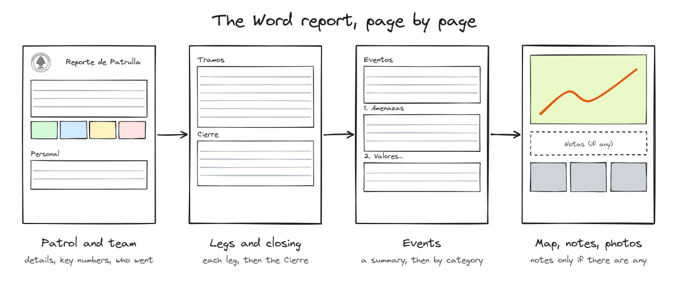

# APN Patrol & Event Report

This Ecoscope workflow creates a report for a single patrol recorded in EarthRanger. You enter the patrol's number, and it builds an interactive dashboard and a Word report in the format used by Argentina's national parks agency, the Administración de Parques Nacionales (APN).

The report brings together everything the team recorded on that patrol: who went, each stretch of the route and how they travelled, what they found along the way, how the patrol ended, and a map of where they went.

  

---

## How to run it

Open the workflow in Ecoscope and fill in the config page from top to bottom:

1. **Data Source:** the park's EarthRanger site, for example `apncentral`.
2. **Time Range:** any dates that include the patrol, with the Buenos Aires timezone.
3. **ID de Patrulla:** the patrol's number, exactly as it appears in EarthRanger, for example `74`.
4. **Optional extras:** map layers such as the park boundary, the map colors, and whether to include event photos (**Download Attachments**).
5. Press **Run**.

The two settings at the very bottom, **Base Maps** and **Report Template**, are already set up, so you can leave them as they are.

### What it reads from EarthRanger

APN records each patrol as a series of **legs** (*tramos*). The team starts a new leg whenever something changes, such as getting off the truck and continuing on horseback, or handing over to another leader. Each leg has its own leader, team and a short form with the mandate and the transport details.

Everything the team records along the way (a sighting, a threat, an infraction) is an **event** linked to the leg it happened on. When they're back, they can fill in the end-of-patrol form, the **Cierre de patrulla**. The GPS route covers the whole patrol.

The report can only show what was recorded: a leg with an empty form, or a patrol without a closing form, simply shows less.

---

## The dashboard

  

The four numbers at the top give the patrol at a glance. Below them, the legs table shows how the patrol unfolded, and the map shows where it went and where each event was recorded. The Word report is in the dashboard's files, ready to download, next to the map's data: the patrol tracks and the events as GIS files (GeoParquet by default; choose GeoPackage, CSV or Parquet under **Data Export**).

| On the dashboard | In English | What it shows |
|---|---|---|
| Distancia total | Total distance | How far the patrol travelled, measured on the GPS route |
| Tiempo total | Total time | How long the patrol lasted, adding up all the legs |
| Tramos | Legs | How many legs the patrol had |
| Eventos | Events | How many events were recorded; the closing form isn't counted |
| Tramos de Patrulla | Patrol legs | Each leg's type, start, end, leader, distance and time |
| Mapa de Patrulla y Eventos | Patrol and events map | The route colored by leg type, with the events marked |

---

## The Word report

  

The report reads like the paper form APN rangers know, filled in for them.

- **Patrol and team.** The patrol number, its mandates, when it started and ended, the same four numbers as the dashboard, and who took part: each leader with their team, plus anyone who joined without an EarthRanger account.
- **Legs and closing.** The patrol leg by leg (how they travelled, when, who led, how far and how long), with everything filled in on each leg's form. The closing form follows on the same page, or a note that none was filed.
- **Events.** A short summary by category, then a table for each category with every event's number, type, time, coordinates and details.
- **Map and photos.** The patrol map and the event photos.

Times are in Buenos Aires time, and answers are written out in full words rather than EarthRanger's internal codes.

---

## Common questions

**The run stops with "No patrol matches the 'ID de Patrulla' in the selected time range".**
The patrol falls outside the dates you chose, or the number isn't right. Widen the time range and check the number in EarthRanger.

**Distancia total shows 0.00 km.**
The patrol has little or no GPS route, for example when the legs only lasted a minute or two.

**Eventos shows 0, but the report has a closing form.**
That's expected: the closing form has its own section and isn't counted as an event.

**A field shows a code instead of a word.**
That event type was switched off in EarthRanger after the event was recorded, so its labels can no longer be looked up.

**Can the report look different?**
Yes. The layout is a Word file in this repository, [`resources/templates/apn_patrol_events_template.docx`](resources/templates/apn_patrol_events_template.docx). Ask the Ecoscope team for changes; they take effect on the next run, with nothing to reinstall.

---

For developers: compiling, checking and releasing the workflow are covered in [DEVELOPMENT.md](DEVELOPMENT.md).
