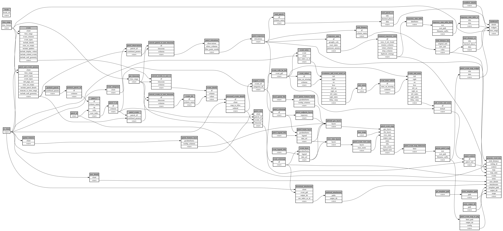

```
# AUTOGENERATED BY ECOSCOPE-WORKFLOWS; see fingerprint in README.md for details

```

```yaml
# fingerprint:
artifacts_sha256_basic: 148eb3b4781338d42ebf3438bd1cc0e704655d1aec120e0d2b8e459b84df1cd7
artifacts_sha256_strict: d5d8784b6d54956e4dc0c8a904f2a5c31190cdd19af4aac51908104a0c2180ff
installed_requirements:
- channel: https://repo.prefix.dev/ecoscope-workflows/
  name: ecoscope-platform
  version: {version: ==2.28.0}
- channel: https://repo.prefix.dev/ecoscope-workflows-custom/
  name: ecoscope-workflows-ext-custom
  version: {version: ==0.1.6}
- channel: conda-forge
  name: pydeck
  version: {version: ==0.9.2}
- channel: https://repo.prefix.dev/ecoscope-workflows-custom/
  name: ecoscope-workflows-ext-apn
  version: {version: ==0.0.32}
params_sha256: b03a7c5391e423dda55babf0c019570a19064a1107697e49d67107cd848bf5eb
spec_sha256: 860b4d7310042180164b0ba9a648631e2e7b84b512f95de34f4ab6ccc25ae483

```

# ecoscope-workflows-patrol-event-workflow


